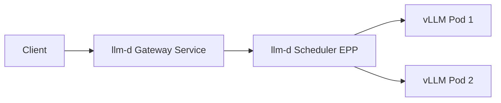

# Phase 1 Architecture



- Client sends OpenAI-compatible requests to a single llm-d gateway URL.
- llm-d scheduler selects a backend vLLM pod.
- vLLM pods serve `/v1/chat/completions`.

## Deploy Mapping

- Namespace default: `kubnamespace` (overridable with `NAMESPACE=...`).
- vLLM manifest: `deploy/vllm/deployment.yaml` applied by `scripts/up.sh`.
- llm-d infra chart values: `deploy/llmd/infra-values.yaml` used by `scripts/up_llmd.sh` with `llm-d-infra/llm-d-infra`.
- llm-d scheduler (InferencePool) values: `deploy/llmd/gaie-values.yaml` used by `scripts/up_llmd.sh` with `oci://registry.k8s.io/gateway-api-inference-extension/charts/inferencepool`.
- HTTPRoute: `deploy/llmd/httproute.yaml` applied by `scripts/up_llmd.sh`.

## Test Defaults

- Direct vLLM test target:
  - Service: `vllm`
  - Port: `8000`
  - Command: `make test-infer`
- llm-d gateway test target:
  - Service: `infra-hello-inference-gateway-istio`
  - Port: `80`
  - Command: `make test-infer SERVICE=infra-hello-inference-gateway-istio PORT=80`

## MIG Mode Detection

Use this to avoid confusion about how GPU resources are being scheduled.

Check node allocatable resources:

```bash
kubectl describe node <your-node> | sed -n '/Allocatable:/,/System Info:/p' | grep -E "nvidia.com/(gpu|mig)"
```

Check what device the pod actually sees:

```bash
kubectl -n <ns> exec <vllm-pod> -- nvidia-smi -L
kubectl -n <ns> exec <vllm-pod> -- bash -lc 'echo NVIDIA_VISIBLE_DEVICES=$NVIDIA_VISIBLE_DEVICES; echo CUDA_VISIBLE_DEVICES=$CUDA_VISIBLE_DEVICES'
```

Check deployment resource requests:

```bash
kubectl -n <ns> get deploy vllm -o yaml | grep -A6 -n "nvidia.com/"
```

### Mode A: Explicit MIG Resources (strict)

- Node allocatable includes `nvidia.com/mig-*`
- Deployment requests `nvidia.com/mig-...: 1`
- Slice profile is explicit and controlled by your request key

### Mode B: MIG-backed "gpu units" (implicit)

- Node allocatable shows `nvidia.com/gpu: N`
- Deployment requests `nvidia.com/gpu: 1`
- Inside pod you may still see `MIG-*` UUIDs via runtime/plugin mapping
- Slice profile selection is implicit (not controlled by pod resource key)
