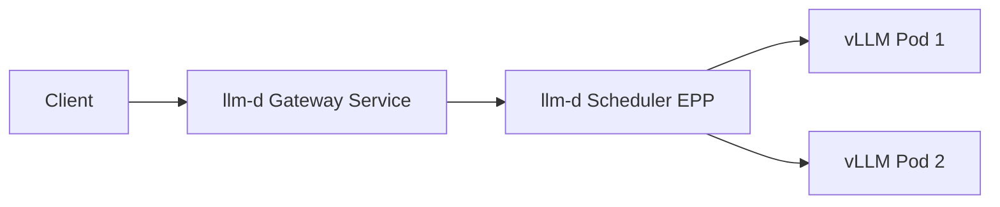

# Phase 1 Architecture

- Client sends OpenAI-compatible requests to a single llm-d gateway URL.
- llm-d scheduler selects a backend vLLM pod.
- vLLM pods serve `/v1/chat/completions`.

## Deploy Mapping

- Namespace default: `kubnamespace` (overridable with `NAMESPACE=...`).
- vLLM manifest: `deploy/vllm/deployment.yaml` applied by `scripts/up.sh`.
- llm-d infra chart values: `deploy/llmd/infra-values.yaml` used by `scripts/up_llmd.sh` with `llm-d-infra/llm-d-infra`.
- llm-d scheduler (InferencePool) values: `deploy/llmd/gaie-values.yaml` used by `scripts/up_llmd.sh` with `oci://registry.k8s.io/gateway-api-inference-extension/charts/inferencepool`.
- HTTPRoute: `deploy/llmd/httproute.yaml` applied by `scripts/up_llmd.sh`.

## Test Defaults

- Direct vLLM test target:
  - Service: `vllm`
  - Port: `8000`
  - Command: `make test-infer`
- llm-d gateway test target:
  - Service: `infra-hello-inference-gateway-istio`
  - Port: `80`
  - Command: `make test-infer SERVICE=infra-hello-inference-gateway-istio PORT=80`
